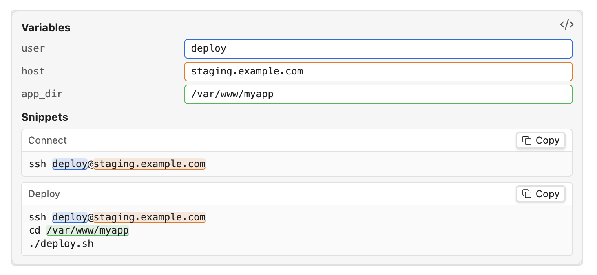

# VarPad for Obsidian

A small Obsidian plugin for editing note-local variables and copying live-rendered text snippets. The first version focuses on VarPad's core loop; it does not port the standalone app's workspace manager, themes, or other extras.



## Why

Some command sequences are too irregular to script but too frequent to retype. Each time through, the steps are the same and only a few values change: an order ID, a pod name, an environment, or a "since" timestamp. Common examples:

- **A routine debug procedure:** look up a record in the database, then pull the matching AWS logs from a specific time onward.
- **Debugging a Kubernetes pod:** describe it, tail its logs, then open a shell in it.
- **Deploying or connecting to servers:** the same SSH and deploy steps against different hosts or users.

Without a tool, this usually means copying an old command from shell history or a notes file and carefully editing each value by hand, which makes it easy to miss one. With VarPad, you keep the procedure in a note, enter this run's values once at the top, and copy each finished command in order. Each value is color-coded, so you can see where it lands in every command. The values are saved with the note, so the last run is there the next time you need it.

A VarPad block can also be a first step toward automation. Once a sequence has been run often enough to be stable, the block already documents the steps in order, and its variables are the parameters a script will need, so turning it into a script is mostly a matter of copying it over.

## Use

Create a `varpad` fenced block in a Markdown note. Both backtick and tilde fences are supported. For example:

````markdown
```varpad
variables:
  user: deploy
  host: staging.example.com
  app_dir: /var/www/myapp

snippets:
  Connect: "ssh {{user}}@{{host}}"
  Deploy: |
    ssh {{user}}@{{host}}
    cd {{app_dir}}
    ./deploy.sh
```
````

The block uses YAML: `variables` is a mapping of names to scalar values; `snippets` maps display labels to template strings. Templates substitute `{{variable_name}}`. Undefined names remain visible in output.

In Reading view, the plugin replaces the source block with editable variable fields and live snippet outputs. Type or paste into a field to update every output immediately; double- or triple-click the field to select its full value. Click a snippet's copy button to copy its current output. Changes are written back to that block in the note when the field is committed, so they persist with the note and sync with the vault.

The YAML is parsed as data; embedded JavaScript is not evaluated.

## Related plugins

Several plugins cover parts of this workflow, and one of them may suit you better:

- **[Live Note Parameters](https://community.obsidian.md/plugins/live-note-parameters):** the closest match. You click `{{NAME}}` references in commands to edit them, with defaults stored in frontmatter. It works across a whole note: parameters can appear anywhere in prose or commands, and values typed while you work stay in the current tab rather than being saved.
- **[Replace Pencil](https://community.obsidian.md/plugins/replace-pencil):** turns `<placeholders>` in code blocks into input fields in Reading view, with a copy button for the filled-in result.
- **[Vault Variables](https://community.obsidian.md/plugins/vault-variables):** vault-wide `{{name}}` values defined in the plugin's settings, rather than edited per run in the note.
- **[Meta Bind](https://community.obsidian.md/plugins/obsidian-meta-bind-plugin):** general-purpose input and view fields bound to frontmatter. A similar form is possible, but you have to assemble it yourself.
- **[Shell commands](https://publish.obsidian.md/shellcommands) and [Templater](https://www.obsidianstats.com/plugins/templater-obsidian):** run commands or generate notes from variables, rather than giving you commands to review and copy.

VarPad is scoped more narrowly than any of these, Live Note Parameters included. Everything lives inside a single `varpad` fenced code block: the variables, the commands, and the last run's values, with nothing in frontmatter, settings, or the rest of the note. That makes a block easy to copy between notes or share as-is, and a note can hold several independent blocks. Inside the block, the variables form a short form at the top, and each one is color-coded: its input border and every place its value appears in the commands share the same color, so you can see at a glance what a change will affect.
